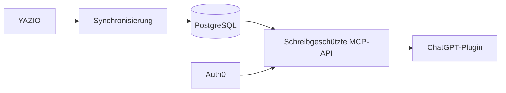

<p align="center">
  
</p>

<h1 align="center">NutriOptimize</h1>

<p align="center">
  Persönliche Ernährungsanalysen aus YAZIO und ChatGPT auf dem eigenen Server.
</p>

<p align="center">
  <a href="README.md">English</a> · <strong>Deutsch</strong>
</p>

## Warum ich NutriOptimize gebaut habe

Ich nutze YAZIO gerne, um mein Essen im Alltag zu erfassen. Der Produktkatalog
ist groß, die App lässt sich gut bedienen und die Fotofunktionen sind praktisch,
wenn sich eine Mahlzeit nicht genau abwiegen lässt, zum Beispiel im Restaurant.

Wenn ich schon Kalorien und Makronährstoffe erfasse, möchte ich aber auch aus den
restlichen Daten etwas lernen. NutriOptimize importiert mein YAZIO-Tagebuch in
eine private Datenbank und stellt es ChatGPT über eine schreibgeschützte
MCP-Verbindung zur Verfügung.

So kann ChatGPT auch Mikronährstoffe betrachten, mehrere Tage vergleichen und
konkrete Verbesserungen vorschlagen. In den Anweisungen des Plugins lässt sich
der persönliche Schwerpunkt festlegen, etwa Muskelaufbau, eine gute
Mikronährstoffversorgung oder die allgemeine Lebensmittelqualität. Fehlen bei
einem Eintrag brauchbare Mikronährstoffdaten, kann ChatGPT vorsichtig schätzen.
Die Schätzung wird klar gekennzeichnet und nicht als gemessener Wert dargestellt.

> [!IMPORTANT]
> YAZIO bietet hierfür keine offizielle öffentliche API an. NutriOptimize nutzt
> eine inoffizielle, schreibgeschützte Schnittstelle, die von der unabhängigen
> YAZIO-Community dokumentiert wurde. Sie wird nicht offiziell unterstützt und
> kann sich jederzeit ändern. Dieses Projekt steht in keiner Verbindung zur
> YAZIO GmbH. Lies vor der Verwendung eines echten Kontos die
> [Hinweise zum Adapter](docs/YAZIO_UNOFFICIAL_API.md).

## So funktioniert es



- PostgreSQL speichert den Verlauf auf dem selbst betriebenen Server.
- Ein kleiner Hintergrunddienst importiert Einträge, Nährstoffe und Tagesziele.
- Caddy stellt HTTPS bereit; Auth0 schützt den MCP-Zugang.
- ChatGPT erhält nur freigegebene Ernährungsdaten, niemals das YAZIO- oder
  Datenbankpasswort.

Die aktuelle Version ist für eine einzelne Person gedacht. Synthetische
Testdaten sind enthalten, damit sich der gesamte Stack prüfen lässt, bevor ein
echtes YAZIO-Konto verbunden wird.

## Installation

Du brauchst einen Linux-Server, eine Domain oder Subdomain, Docker Compose, ein
Auth0-Konto und die Möglichkeit, ein privates ChatGPT-Plugin zu erstellen.
Getestet wurde Ubuntu 24.04 auf Hetzner Cloud, beides ist aber keine
Voraussetzung.

### 1. Server absichern

Verwende einen Ed25519-SSH-Schlüssel und einen normalen Administrator mit
`sudo`. Deaktiviere den Root- und Passwort-Login erst, nachdem die Anmeldung per
Schlüssel erfolgreich getestet wurde. Aktiviere automatische
Sicherheitsupdates und richte sowohl beim Anbieter als auch auf dem Server eine
Firewall ein.

| Port | Quelle | Verwendung |
|---|---|---|
| TCP 22 | wenn möglich nur deine IP | SSH |
| TCP 80 | überall | HTTPS-Einrichtung und Weiterleitung |
| TCP 443 | überall | MCP über HTTPS |

Die Ports 5432 und 8000 dürfen nicht öffentlich erreichbar sein. Die
[allgemeine Self-Hosting-Anleitung](docs/SELF_HOSTING.md) erklärt den Aufbau; die
[Hetzner-Anleitung](docs/HETZNER_SETUP.md) zeigt ein konkretes Beispiel.

### 2. NutriOptimize installieren

Richte den gewählten Hostnamen auf den Server, installiere Docker Engine mit dem
Compose-Plugin und klone das Repository:

```sh
sudo mkdir -p /srv
sudo git clone https://github.com/viktorkoenigbauer/nutrioptimize.git /srv/nutrioptimize
sudo chown -R "$USER":"$USER" /srv/nutrioptimize
cd /srv/nutrioptimize
./scripts/setup.sh
```

Der Einrichtungsassistent erstellt `.env`, erzeugt lokale Zugangsdaten und fragt
auf Wunsch die YAZIO-Zugangsdaten ab. Geheimnisse werden nie ausgegeben. Eine
bestehende Konfiguration wird nicht überschrieben.

Starte zuerst mit den enthaltenen Testdaten:

```sh
sudo docker compose up --build -d db migrate api caddy
sudo docker compose run --rm sync python -m app.sync_once
curl https://DEIN-HOST/health/ready
```

Wenn die Antwort `{"status":"ready"}` lautet, teste einmal den echten Import
und starte danach die regelmäßige YAZIO-Synchronisierung:

```sh
sudo docker compose -f compose.yaml -f compose.yazio.yaml \
  run --rm sync python -m app.sync_once
sudo docker compose -f compose.yaml -f compose.yazio.yaml up -d sync
```

Die [Hinweise zum YAZIO-Adapter](docs/YAZIO_UNOFFICIAL_API.md) erklären die von
der Community dokumentierten Client-Werte und den jeweils aktuellen User-Agent.

### 3. Auth0 einrichten

Erstelle einen eigenen Auth0-Tenant und führe diese Schritte aus:

1. Lege eine API mit dem Namen `NutriOptimize MCP` an.
2. Verwende `https://DEIN-HOST/mcp/` als Identifier.
3. Wähle RS256 und füge die Berechtigung `nutrition:read` hinzu.
4. Aktiviere das Resource Parameter Compatibility Profile und Offline Access.
5. Lege den vorgesehenen Benutzer an und deaktiviere die öffentliche
   Registrierung.
6. Kopiere die unveränderliche Auth0-Benutzer-ID (`auth0|...`).
7. Registriere `https://chatgpt.com/oauth/client.json` und erteile
   `nutrition:read`.

Trage die öffentlichen OAuth-Kennungen und die erlaubte Benutzer-ID in `.env`
ein, stelle `MCP_AUTH_MODE` auf `oauth` und baue die API neu. Die
[OAuth-Anleitung](docs/OAUTH_SETUP.md) enthält alle Felder und Prüfschritte.

### 4. ChatGPT verbinden

Erstelle ein privates Plugin und füge die MCP-Konfiguration aus der
[OAuth-Anleitung](docs/OAUTH_SETUP.md#plugin-connection-declaration) hinzu.
Verbinde das Plugin, melde dich über Auth0 an und probiere zum Beispiel:

```text
Was habe ich heute gegessen und welche Nährstoffe könnten mir noch fehlen?
```

Persönliche Ziele gehören in die Anweisungen des Plugins. Ein möglicher
Ausgangspunkt ist:

```text
Analysiere meine Ernährung mit Blick auf Muskelaufbau und eine ausgewogene
Mikronährstoffversorgung. Behandle fehlende Nährstoffwerte als unbekannt. Gib
bei Restaurant- oder Fotoeinträgen mit unvollständigen Daten eine vorsichtige
Schätzung ab, kennzeichne sie eindeutig und nenne die wichtigsten Annahmen.
```

## Sicherheit und Datenschutz

- Der MCP-Zugang ist schreibgeschützt und kann das YAZIO-Tagebuch nicht ändern.
- Zugangsdaten liegen in zugriffsbeschränkten Docker-Secret-Dateien.
- OAuth prüft Token, Berechtigung und die ausdrücklich erlaubte Benutzer-ID.
- Auth0 erhält Anmeldedaten, aber weder Tagebuchdaten noch YAZIO-Zugangsdaten.
- Fehlende Mikronährstoffe bleiben in der Datenbank unbekannt.
- Das Projekt dient der Ernährungsanalyse und ersetzt keine medizinische
  Beratung.

Lies vor dem Import persönlicher Daten [SECURITY.md](SECURITY.md),
[PRIVACY.md](PRIVACY.md) und das
[Sicherheitsmodell](docs/SECURITY_MODEL.md).

## Server aktualisieren

Änderungen laufen über einen Branch, einen Pull Request und GitHub Actions.
Sobald eine geprüfte Version in `main` liegt, wird der Server so aktualisiert:

```sh
cd /srv/nutrioptimize
./scripts/deploy.sh
```

Das Skript sichert PostgreSQL, lädt die geprüfte Version, baut den Stack neu und
prüft anschließend die API. Weitere Informationen stehen in der
[Deployment-Anleitung](docs/DEPLOYMENT.md).

## Hinweise zum Projekt

Der Stack verwendet Python, FastAPI, SQLAlchemy, Alembic, PostgreSQL, das Python
MCP SDK, Docker Compose und Caddy. Die erste Beta ist eine
Single-User-Referenzimplementierung für technisch erfahrene Self-Hoster und kein
gehosteter Dienst. Dateien und Git-Historie wurden auf Geheimnisse geprüft. Das
Projekt steht unter der [MIT-Lizenz](LICENSE).

Mehr dazu: [Architektur](docs/ARCHITECTURE.md) ·
[Änderungen](CHANGELOG.md) · [Mitarbeit](CONTRIBUTING.md) ·
[Veröffentlichung](docs/PUBLISHING.md)
