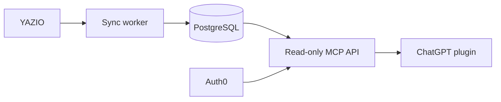

<p align="center">
  
</p>

<h1 align="center">NutriOptimize</h1>

<p align="center">
  Personal nutrition insights from YAZIO and ChatGPT, running on your own server.
</p>

<p align="center">
  <strong>English</strong> · <a href="README.de.md">Deutsch</a>
</p>

## Why I built it

I like YAZIO for everyday food tracking. Its product catalogue is large, the
app is easy to use and its photo features are practical when a meal cannot be
weighed properly, for example in a restaurant.

But if I already track calories and macros, I also want to learn from the rest
of the data. NutriOptimize imports my YAZIO diary into a private database and
makes it available to ChatGPT through a read-only MCP connection.

That lets ChatGPT look at micronutrients, compare several days and suggest
practical changes. The plugin instructions set the personal focus, such as
muscle gain, micronutrient coverage or general food quality. When an entry has
no useful micronutrient data, ChatGPT can provide a conservative estimate. It
is clearly labelled and never presented as a measured value.

> [!IMPORTANT]
> YAZIO does not provide an official public API for this. NutriOptimize uses an
> unofficial, read-only interface documented by the independent YAZIO
> community. It is unsupported and may change without notice. This project is
> not affiliated with YAZIO GmbH. Read the
> [adapter notes](docs/YAZIO_UNOFFICIAL_API.md) before using a real account.

## How it works



- PostgreSQL keeps the diary history on the self-hosted server.
- A small worker imports entries, nutrients and daily targets.
- Caddy provides HTTPS; Auth0 protects the MCP endpoint.
- ChatGPT receives authorised nutrition data, never YAZIO or database
  passwords.

The default setup is private and single-user. Synthetic data is included, so the
whole stack can be tested before connecting a YAZIO account.

## Installation

You need a Linux server, a domain or subdomain, Docker Compose, an Auth0 account
and access to create a private ChatGPT plugin. Ubuntu 24.04 on Hetzner Cloud is
the tested example, but it is not a requirement.

### 1. Secure the server

Use an Ed25519 SSH key and a normal administrator with `sudo`. Disable root and
password SSH login only after key login has been tested. Enable automatic
security updates and configure the provider and host firewalls.

| Port | Source | Used for |
|---|---|---|
| TCP 22 | your IP if possible | SSH |
| TCP 80 | anywhere | HTTPS setup and redirect |
| TCP 443 | anywhere | MCP over HTTPS |

Do not expose ports 5432 or 8000. The
[self-hosting guide](docs/SELF_HOSTING.md) explains the general setup; the
[Hetzner guide](docs/HETZNER_SETUP.md) shows one concrete example.

### 2. Install NutriOptimize

Point the chosen hostname to the server, install Docker Engine with the Compose
plugin and clone the repository:

```sh
sudo mkdir -p /srv
sudo git clone https://github.com/viktorkoenigbauer/nutrioptimize.git /srv/nutrioptimize
sudo chown -R "$USER":"$USER" /srv/nutrioptimize
cd /srv/nutrioptimize
./scripts/setup.sh
```

The setup assistant creates `.env`, generates local secrets and optionally asks
for the YAZIO credentials. It never prints secrets and refuses to overwrite an
existing configuration.

Start with the included test data:

```sh
sudo docker compose up --build -d db migrate api caddy
sudo docker compose run --rm sync python -m app.sync_once
curl https://YOUR-HOST/health/ready
```

After the response is `{"status":"ready"}`, test one live import and start the
regular YAZIO sync:

```sh
sudo docker compose -f compose.yaml -f compose.yazio.yaml \
  run --rm sync python -m app.sync_once
sudo docker compose -f compose.yaml -f compose.yazio.yaml up -d sync
```

The [YAZIO adapter notes](docs/YAZIO_UNOFFICIAL_API.md) explain the required
community-documented client values and current user agent.

### 3. Configure Auth0

Create a separate Auth0 tenant and:

1. create an API named `NutriOptimize MCP`;
2. use `https://YOUR-HOST/mcp/` as its identifier;
3. select RS256 and add `nutrition:read`;
4. enable the Resource Parameter Compatibility Profile and offline access;
5. create the intended user and disable public sign-up;
6. copy the user's immutable Auth0 ID (`auth0|...`);
7. register `https://chatgpt.com/oauth/client.json` and grant it
   `nutrition:read`.

Put the public OAuth identifiers and allowed user ID in `.env`, switch
`MCP_AUTH_MODE` to `oauth`, then rebuild the API. The
[OAuth guide](docs/OAUTH_SETUP.md) lists the exact fields and checks.

### 4. Connect ChatGPT

Create a private plugin and add the MCP declaration from the
[OAuth guide](docs/OAUTH_SETUP.md#plugin-connection-declaration). Connect it,
complete the Auth0 login and try:

```text
What did I eat today, and which nutrients may still be missing?
```

Personal goals belong in the plugin instructions. A useful starting point is:

```text
Analyse my nutrition with a focus on muscle gain and balanced micronutrient
intake. Treat missing nutrient values as unknown. For restaurant or photo-based
entries with incomplete data, give a conservative estimate, label it clearly
and state the main assumptions.
```

## Security and privacy

- MCP access is read-only and cannot edit the YAZIO diary.
- Credentials stay in permission-restricted Docker secret files.
- OAuth checks the token, scope and explicitly allowed user ID.
- Auth0 receives login metadata, not diary data or YAZIO credentials.
- Missing micronutrients remain unknown in the database.
- This project provides nutrition analysis, not medical advice.

See [SECURITY.md](SECURITY.md), [PRIVACY.md](PRIVACY.md) and the
[security model](docs/SECURITY_MODEL.md) before importing personal data.

## Updating the server

Changes go through a branch, pull request and GitHub Actions. After a reviewed
version reaches `main`, update the server with:

```sh
cd /srv/nutrioptimize
./scripts/deploy.sh
```

The script backs up PostgreSQL, pulls the reviewed revision, rebuilds the stack
and checks that the API is ready. More details are in the
[deployment guide](docs/DEPLOYMENT.md).

## Project notes

The stack uses Python, FastAPI, SQLAlchemy, Alembic, PostgreSQL, the Python MCP
SDK, Docker Compose and Caddy. The first beta is a single-user reference
implementation for technically experienced self-hosters, not a hosted service.
Its files and Git history have been checked for secrets. The project is released
under the [MIT License](LICENSE).

More detail: [architecture](docs/ARCHITECTURE.md) ·
[changelog](CHANGELOG.md) · [contributing](CONTRIBUTING.md) ·
[release checklist](docs/PUBLISHING.md)
